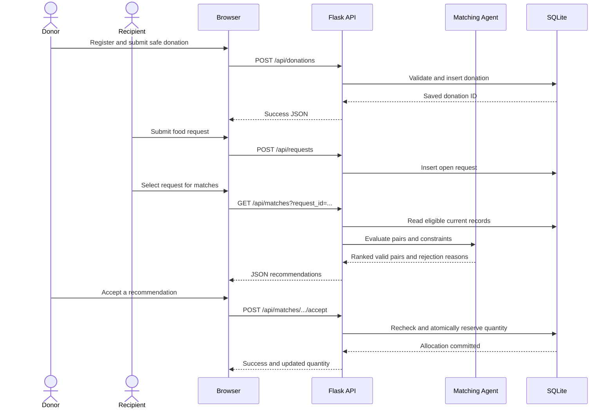

# FoodShare AI Matching Algorithm

## What Problem Does It Solve?

FoodShare receives a set of food donations and recipient requests. The matching agent checks whether a donation can safely and completely satisfy a request, explains the decision, and helps allocate limited quantities without assigning stock twice.

The algorithm is a **rule-based heuristic plus state-space search**. It does not train a model and is not machine learning.

## Inputs and Outputs

A donation has an ID, category, quantity, unit, status, safety confirmation, timezone-aware expiry time, and optional named pickup area. A request has an ID, category, quantity, unit, status, urgency, and optional named area.

For each pair, the evaluator returns the donation and request IDs, eligibility, score for valid pairs, reasons, rejected constraints, and a next action. The matching API reads current records from SQLite. Experiment input is separate synthetic CSV data.

## Hard Constraints

A pair is rejected before scoring if any of these are true:

- A record ID, category, quantity, unit, or urgency is missing or invalid.
- Categories differ after whitespace/case normalization.
- Quantity is not a positive finite number, units differ, or the donation cannot satisfy the complete request.
- Donation status is not `available` or request status is not `open`/`pending`.
- Safety is not explicitly confirmed.
- The expiry timestamp is invalid, lacks a timezone, or has passed.

A score cannot override a hard rejection. The live recommendation API returns only eligible records and separately reports rejected constraints for explanation.

## Score

Valid pairs receive a compatibility score on a 0-100 scale:

```text
score = category + quantity + urgency + location

category = 40 points for exact normalized category equality
quantity = 25 * requested quantity / currently remaining donation quantity
urgency = low: 5, medium: 12, high: 20
location = 15 for same known named area; 5 for different known areas; 0 if either is missing
```

The score is a ranking value, not a probability of pickup success. Location compares only the supplied area text; it does not estimate distance. The current system requires a complete request quantity and does not split one request across multiple donations.

## Allocation Formulation

### State

- Current request index.
- Remaining quantity for every donation.
- Assignments made so far.
- Total compatibility score.

### Actions

For the current request, assign it to any eligible donation that has enough remaining quantity, or leave it unmatched.

### Goal and objective

A goal state has considered every request and contains only valid assignments. The search maximizes a two-part objective lexicographically:

1. Number of fully satisfied requests.
2. Sum of their compatibility scores.

A request can be assigned at most once; donor stock cannot go below zero. The assignment is committed to SQLite only after a donor/admin acceptance endpoint rechecks the hard constraints in a write transaction.

### Greedy baseline

The greedy allocator repeatedly selects the highest-scoring currently feasible pair, reserves that quantity in its in-memory state, and removes that request from the pending set. It is fast and simple but makes local choices that can block a better overall allocation.

### Search method

The exhaustive depth-first search tries every feasible donation for each request plus the option to leave that request unmatched. It tracks remaining inventory and chooses the best complete allocation under the objective above. This is appropriate for a small course demonstration because every state and decision can be explained. It becomes too slow as input grows.

## Pseudocode

```text
MATCH(donation, request):
    failures = check IDs, categories, units, quantities, statuses, safety, expiry, urgency
    if failures exist:
        return rejected pair with failures
    calculate category, quantity, urgency, and optional location points
    return eligible pair with score and reasons

SEARCH(request_index, remaining_stock, assignments, score):
    if all requests have been considered:
        keep this result if it satisfies more requests,
        or ties request count and has a higher total score
        return
    request = current request
    for each donation with enough remaining stock:
        if MATCH(donation, request) is eligible:
            reserve the full quantity and recurse on the next request
    recurse once more leaving the request unmatched
```

## Complexity

Let `R` be the number of requests, `D` the number of donations, and `C` the cost of one fixed-size pair check.

- Pair ranking evaluates every pair: `O(D * R * C)` time.
- Greedy repeatedly scans remaining pairs after each assignment: upper bound `O(R^2 * D * C)` time.
- Exhaustive search has at most `D + 1` choices per request (a donation or unmatched), so it explores `O((D + 1)^R)` leaves. With donation checks and inventory-state copying, a conservative bound for this implementation is `O(D * (D + 1)^R * C)` time and `O(R * D)` state memory.

The exhaustive allocator is for small inputs only. A larger service would need pruning, a matching/flow algorithm, or an integer optimizer.

## Live Application Flow



## Assumptions and Limitations

- The donor's safety checkbox is a user declaration; software cannot inspect food condition.
- Categories and units must exactly match after basic normalization. There is no category ontology or unit conversion.
- There is no geocoding or exact-distance calculation.
- Recipients are not partially fulfilled; one donation must cover a request.
- The score weights are manually selected, not learned from outcomes.
- The backend uses server-side authorization; hiding a form in the browser is not treated as security.
- The capstone comparison uses synthetic records and is not evidence of real community impact.
