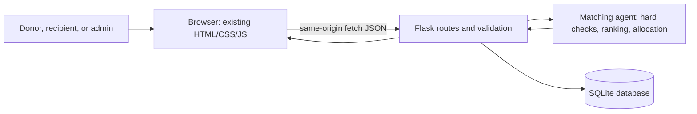

# FoodShare AI

FoodShare AI is a community food-sharing demonstration with a pastel HTML/CSS/JavaScript website, a Flask JSON API, an SQLite database, and an explainable rule-based food matching agent. Its matching agent is not machine learning. The experiment runner uses synthetic records that are separate from actual app submissions.

## What Works

- Register donor and recipient accounts; administrators are promoted only when their email is listed in the server's `FOODSHARE_ADMIN_EMAILS` setting before they register.
- Passwords are stored as hashes. Sessions use HTTP-only, SameSite cookies and mutating API requests require a CSRF token.
- Donors can submit safe, unexpired listings and change their own available listings to unavailable.
- Recipients can submit requests and view matches only for their own requests.
- Public search/category filters show current available food without disclosing donor contact details.
- The matching API rejects unsafe, expired, unavailable, incompatible, unit-mismatched, malformed, or insufficient pairs before scoring.
- A donor or administrator can accept a match; this creates a **reserved** allocation and moves stock from available to reserved in a SQLite transaction. It does not mark the food collected.
- The recipient who owns the request, or an administrator, can confirm collection. Only this confirmation counts as collected.
- The recipient or administrator can cancel an open or reserved request. A reserved quantity is restored only in a guarded transaction that checks the donation's total quantity limit.
- The admin dashboard separates available, reserved, recipient-confirmed collected, cancelled, and expired quantities by their original units. Allocated or reserved food is not labeled rescued.
- A separate reproducible synthetic experiment compares greedy allocation with exhaustive search.

## Current Limitations

- There is no production deployment configuration, email verification, password reset, rate limiting, or external identity provider.
- Administrator access is configured by email allowlist; protect that environment setting and use a real, trusted address.
- This is a college demo, not a production-secure food safety or logistics service. Safety confirmation is a donor declaration; software cannot inspect food.
- Location matching compares named text labels only. There are no coordinates, geocoding, or exact distances.
- Categories and units require exact matches after simple normalization; there is no unit conversion or partial request allocation.
- Exhaustive search grows exponentially and is for the small experiment dataset, not large live workloads.
- Notifications are browser success/error messages only; there is no persisted notification inbox.
- SQLite is appropriate for a local, single-process demonstration. For multiple instances or persistent cloud deployments, choose a managed relational database or a host-supported persistent volume before deployment.
- Legacy database migration is versioned using SQLite `user_version`. Existing allocations are conservatively migrated as `reserved`, not `collected`, because the old application recorded acceptance but did not record pickup confirmation.
- The old homepage impact figures remain clearly marked illustrative; use the database-backed admin snapshot for saved application activity.

## Technologies

- Python 3.11 or newer
- Flask 3.x
- SQLite (Python standard library)
- HTML, CSS, and browser JavaScript using `fetch()`
- Waitress for a production-style WSGI server that works on Windows
- pytest for tests and Matplotlib for the experiment charts

## Folder Structure

```text
FoodShareAI/
  app.py                         Flask app, API routes, auth, and SQLite setup
  matching_agent.py              Hard constraints, score, greedy/search allocation
  index.html                     Existing website plus connected forms and sections
  style.css                      Existing pastel theme plus form/dashboard styles
  script.js                      Menu interactions and API fetch integration
  tests/
    test_app_api.py              Flask/database/security workflow tests
    test_matching_agent.py       Matching/allocation unit tests
  experiments/
    data/                         Clearly synthetic experiment input CSVs
    results/                      Measured run CSVs and charts
    run_experiment.py             Evaluation and chart generator
  run_experiments.py              Simple root command for the experiment
  AI_ALGORITHM.md                Algorithm explanation and workflow diagram
  EXPERIMENTS.md                 Experiment instructions and observed output
  docs/                           Report, architecture, demo, viva, and review notes
  instance/                       Local SQLite database (ignored by Git)
```

## First-Time Setup: Windows PowerShell

Open the FoodShareAI folder in VS Code. In its terminal:

```powershell
python --version
python -m venv .venv
.venv\Scripts\Activate.ps1
python -m pip install --upgrade pip
python -m pip install -r requirements.txt
```

If PowerShell blocks virtual-environment activation, run this for the current terminal only, then activate again:

```powershell
Set-ExecutionPolicy -Scope Process -ExecutionPolicy Bypass
.venv\Scripts\Activate.ps1
```

## Configure Local Demo

Set a private session key and an admin email before starting the server. These values apply only to the current PowerShell window. Do not commit a real secret to source control.

```powershell
$env:FOODSHARE_SECRET_KEY = (& python -c "import secrets; print(secrets.token_urlsafe(32))").Trim()
$env:FOODSHARE_ADMIN_EMAILS = "your-real-admin-email@example.com"
$env:FOODSHARE_DATABASE = Join-Path $PWD "instance/foodshare.sqlite3"
$env:FOODSHARE_ENV = "development"
```

Replace the example email with an address you control. Register that account after starting the app; the server assigns the admin role based on the allowlist. Normal users must not be able to choose admin in the registration form. The local SQLite database is created automatically when Flask starts. It lives in `instance/` and is excluded from Git because it contains user data.

## Start the Website

For the college demo on your local Windows computer, use Waitress:

```powershell
waitress-serve --listen=127.0.0.1:5000 app:app
```

Open <http://127.0.0.1:5000>. The backend serves the existing HTML, CSS, and JavaScript from the same origin, so the browser can call the API without a separate server. Stop the local server with `Ctrl+C`.

For quick development only, `python app.py` also starts Flask with debug mode off. Flask's built-in server is not a production server. For deployment, use the hosting provider's production WSGI command and secure environment settings.

## Run Tests and Synthetic Experiment

```powershell
python -m pytest -q
python run_experiments.py
```

The tests use temporary SQLite databases and do not insert into your local demo database. The experiment runner reads the synthetic CSV files and writes actual output under `experiments/results/`; it does not use the application database. The generated results are reproducible in matching counts and quantities, while runtime will vary by machine.

## Main API Routes

| Method | Route | Purpose |
| --- | --- | --- |
| GET | `/api/csrf` | Get session CSRF token for browser mutations |
| POST | `/api/register` | Create donor/recipient account |
| POST | `/api/login` | Verify account and start session |
| POST | `/api/logout` | End session |
| GET | `/api/donations` | Search available listings; accepts `q` and `category` |
| POST | `/api/donations` | Create a validated donation (donor/admin) |
| GET | `/api/my/donations` | View current user's own donations (donor/admin) |
| PATCH | `/api/donations/<id>/status` | Change own listing status (owner/admin) |
| GET | `/api/requests` | List own requests or all requests for admin |
| POST | `/api/requests` | Create a food request (recipient/admin) |
| GET | `/api/matches?request_id=<id>` | Get explained matches for own request |
| GET | `/api/matches` | Donor/admin matching for open requests (donors see own listings only) |
| POST | `/api/matches/<donation_id>/<request_id>/accept` | Recheck and reserve a match (owner/admin) |
| POST | `/api/allocations/<allocation_id>/collect` | Confirm pickup as the request owner/admin |
| POST | `/api/requests/<id>/cancel` | Cancel an open request or reserved allocation (owner/admin) |
| GET | `/api/dashboard` | Real aggregate totals and recent activity (admin only) |

All SQL values are passed as bound parameters. The app returns JSON errors with appropriate status codes; internal exception details are logged server-side and not returned to the browser.

## Live Demonstration Steps

1. Start the server and open the local URL.
2. Register a donor account and submit a safe donation with a future best-before time.
3. Sign out and register a recipient account.
4. Submit a request with the same category and unit and no more than the available quantity.
5. Open the matching section, select the request, and show the score and reasons.
6. Sign in as the donor, open matching for their own listings, and accept the recommendation. Explain that it is now **reserved**, not yet collected.
7. Sign in as the recipient, confirm collection, then show that the request is collected and the quantity moves from reserved to collected.
8. Sign in using the configured admin email and open Community Snapshot to show saved counts and quantities by lifecycle and unit.
9. Run `python -m pytest -q` and `python run_experiments.py` if faculty want to inspect validation and synthetic comparisons.

Use test accounts and synthetic food descriptions during a classroom demo. Do not enter real personal contact details on an internet-accessible deployment.

## Architecture Diagrams

See [AI_ALGORITHM.md](AI_ALGORITHM.md) for the allocation search and donor-to-agent-to-recipient workflow. The architecture for the application is:



## Security and Deployment Notes

- Set `FOODSHARE_SECRET_KEY` to a long random secret outside the source code.
- Set `FOODSHARE_ENV=production` behind HTTPS; this enables secure session cookies. Production refuses the known local demo key.
- Set `FOODSHARE_ADMIN_EMAILS` only for authorized administrators. Register the admin account only after this variable is configured.
- Never publish `instance/`, `.env`, passwords, contact data, or a real SQLite database.
- The app has basic sessions, password hashing, CSRF checks, and role/record ownership checks, but it has not undergone a professional security review. Do not call it production-secure.
- On first startup after this upgrade, the app applies schema version 1 inside a transaction. It adds reserved inventory and allocation lifecycle fields, rebuilds request/allocation tables to support lifecycle states, and marks historical allocations as reserved. It does not delete user, donation, request, or allocation rows. Back up the database before deploying any schema-changing version.
- SQLite writes to a local file. A cloud host with an ephemeral filesystem can erase the DB on restart, and a local file is not shared safely across multiple instances. Use a supported persistent disk for a single-instance demonstration or choose managed PostgreSQL before scaling. Do not switch/migrate data without a backup and explicit plan.

## Review Materials

- [AI algorithm details](AI_ALGORITHM.md)
- [Experiment method and observed results](EXPERIMENTS.md)
- [Project report](docs/PROJECT_REPORT.md)
- [Three-minute demonstration script](docs/REVIEW_2_DEMO.md)
- [Faculty viva questions](docs/FACULTY_VIVA.md)
- [Team responsibility template](docs/TEAM_RESPONSIBILITIES.md)
- [Architecture and workflow diagrams](docs/ARCHITECTURE.md)
