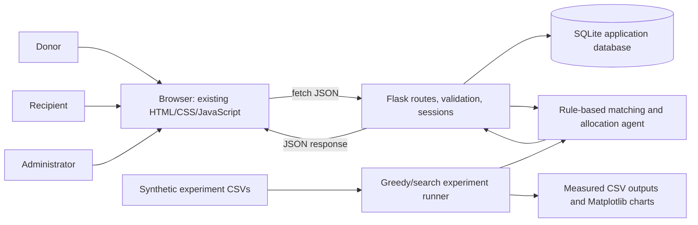
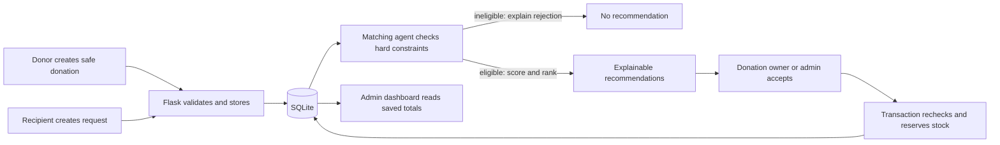

# FoodShare AI Architecture

This diagram shows the implemented local demonstration. The matching agent reads current application records through Flask for live recommendations. The experiment runner separately reads synthetic CSV inputs; experiment data is not imported into the live database.

## Live Workflow

## Key Boundaries

- `index.html`, `style.css`, and `script.js` provide the pastel website and call the API with `fetch()`.
- `app.py` serves the frontend and provides authentication, donation, request, matching, acceptance, and admin-summary routes.
- `matching_agent.py` applies hard constraints, creates reasoned scores, and implements greedy/exhaustive allocation methods.
- `instance/foodshare.sqlite3` is generated at startup and stores accounts, donations, requests, and allocations. The database directory is ignored by Git.
- `experiments/data/` contains fixed synthetic records. `experiments/run_experiment.py` writes metrics and charts without using the app database.

## Safety Rules

- Eligibility is checked by Python on current records, not by the browser.
- Match acceptance verifies ownership and rechecks constraints in a SQLite write transaction.
- Invalid pairs are excluded from recommendations; their constraints are returned separately for explanation.
- Dashboard values are calculated from saved application records. Allocated quantities are grouped by unit and are not verified impact estimates.